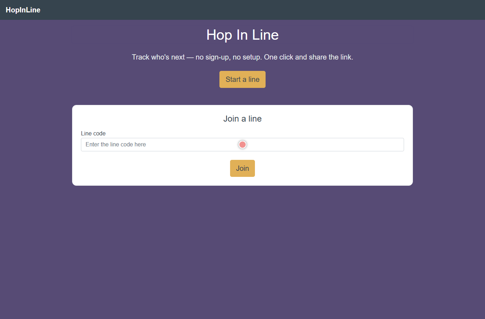

HopInLine is a collaborative queue management app. See a demo: https://www.youtube.com/watch?v=EdSlyLtdO0w

[](docs/feature-tour.mp4)

*Feature tour video: click the image to play.*

## Host Your Own

HopInLine has no accounts and no external services. It's one container that stores everything in a single SQLite file. Pick one of these options:

### Option 1: Any server with Docker (recommended)

This works on any Linux VPS, home server, or Raspberry Pi 4/5 (amd64 or arm64; 512 MB RAM is enough). Install [Docker](https://docs.docker.com/engine/install/), then run:

```sh
git clone https://github.com/yusuken64/HopInLine.git
cd HopInLine
docker compose up -d
```

Open `http://<your-server>:8080`. That's all.

**Add HTTPS on your own domain.** The bundled [Caddy](https://caddyserver.com/) proxy gets a free Let's Encrypt certificate and renews it for you:

1. Point your domain's DNS (A record) at the server, and open ports 80 and 443.
2. `cp .env.example .env`, then uncomment and fill in the four HTTPS lines:
   ```sh
   COMPOSE_PROFILES=https
   DOMAIN=queue.example.com
   ALLOWED_HOSTS=queue.example.com
   HOPINLINE_BIND=127.0.0.1
   ```
3. `docker compose up -d`, then open `https://queue.example.com`.

**Without cloning.** If you just want the container, run:
```sh
docker run -d --name hopinline -p 8080:8080 -v hopinline-data:/data --restart unless-stopped ghcr.io/yusuken64/hopinline:latest
```

**Everyday tasks**

| Task | Command (run in the `HopInLine` folder) |
|---|---|
| Update to the latest version | `git pull && docker compose pull && docker compose up -d` |
| View logs | `docker compose logs -f web` |
| Back up | `docker compose cp web:/data ./hopinline-backup` |
| Stop | `docker compose down` (your data stays in the `hopinline-data` volume) |

### Option 2: Azure, with one click

[](https://portal.azure.com/#create/Microsoft.Template/uri/https%3A%2F%2Fraw.githubusercontent.com%2Fyusuken64%2FHopInLine%2Fmain%2Fdeploy%2Fazure%2Fazuredeploy.json)

This creates an App Service (B1) and an Azure SQL Basic database, for about $18/month in total. Choose a resource group, set a SQL admin password, and click **Create**. The app's URL appears under the deployment's **Outputs**. The first start takes a few minutes while the container is pulled and the database is set up.

### Option 3: Your own SQL Server

For larger deployments, see [Running with SQL Server](#running-with-sql-server-docker) and [Deploying to Production](#deploying-to-production).

### Settings

These environment variables are all optional. With compose, add them under `web:` → `environment:` in `docker-compose.yml`.

| Variable | Default | Purpose |
|---|---|---|
| `LineRetention__IdleDays` | `30` | Delete lines with no activity for this many days. |
| `AllowedHosts` | `*` | The host names the app answers to. |
| `Database__Provider` | `Sqlite` in the image | `Sqlite` or `SqlServer`. |
| `ConnectionStrings__DefaultConnection` | `Data Source=/data/hopinline.db` | The database connection string. |

## Line Access Model

A line has two URLs with different privileges:

- **`/view-line/{id}`** — share this. Anyone with this URL can see the queue and join it. They cannot advance, reorder, remove, edit, or delete.
- **`/manage/{id}/{token}`** — keep this. Anyone with it has full control of the line.

**Start A Line** walks through four short steps: line info and type, your info, initial people, and invite links. Every field is optional, so clicking Next all the way through still gives you a working line. Settings can be changed later from **Edit**. Joining needs no info either: a blank name joins as a guest, and the last name you used is remembered in the browser.

**Important:** The manage link is saved in your browser's recent lines, but there are no accounts, so it can't be recovered if you lose it on that browser. Bookmark it or copy it from the manage page.

## Abuse Protection

- **Rate limits.** Every call that touches the server is limited:
  - Per IP on all HTTP requests (300/min), which covers page loads and new connections.
  - Per browser tab and per IP inside the app, for creating lines, any change, and loads or token checks.
  - Per line on joins (20/min). Managers adding people are exempt.

  Limits are in memory, so each server instance counts separately.
- **Idle-line cleanup.** Lines with no user activity for 30 days are deleted. Set `LineRetention:IdleDays` to change that. Background auto-advance doesn't count as activity.

## Running Locally

The quickest way needs no database server. It uses a SQLite file, `hopinline.db`, in the project folder:
```
dotnet run --project HopInLine --Database:Provider=Sqlite --ConnectionStrings:DefaultConnection="Data Source=hopinline.db"
```

To use SQL Server instead:

1. Set the database connection string in user secrets:
   ```
   dotnet user-secrets set "ConnectionStrings:DefaultConnection" "<your connection string>" --project HopInLine
   ```
   Example connection string (local SQL Server with `sa` user):
   ```
   Server=localhost;Database=hopinline;User=sa;Password=<your password>;Encrypt=True;TrustServerCertificate=True
   ```

2. Apply migrations:
   ```
   dotnet ef database update --project HopInLine
   ```

3. Run the app:
   ```
   dotnet run --project HopInLine
   ```

The app will be at `http://localhost:5000` (or the URL shown in the console).

## Running with SQL Server (Docker)

This setup runs a SQL Server container alongside the app. It needs an amd64 host with about 2 GB of RAM.

1. Change to the HopInLine project directory:
   ```
   cd HopInLine
   ```

2. Create `.env` from the example and fill in both passwords. Compose refuses to start while either one is blank:
   ```
   cp .env.sqlserver.example .env
   openssl rand -base64 24   # run twice, once for each password
   ```
   The `.env` file is gitignored and must never be committed.

3. Build and run:
   ```
   docker compose -f docker-compose.sqlserver.yml up --build --force-recreate
   ```
   `--force-recreate` replaces existing containers on every run so they always pick up the freshly built image. Named volumes (database data, data-protection keys) are preserved.

The app will be at `http://localhost:8080`. The container runs as the non-root `app` user and listens on 8080, not 80.

Migrations run once as `sa`, and the app then connects as the least-privilege `hopinline_app` login. `TrustServerCertificate=True` is on by default because the SQL Server container uses a self-signed certificate. See [Deploying to Production](#deploying-to-production) for a real deployment.

## Deploying to Production

- **Database login.** Don't connect as `sa`. Create a dedicated login and give it only what the app needs:
  ```sql
  CREATE LOGIN hopinline_app WITH PASSWORD = '<strong password>';
  USE hopinline;
  CREATE USER hopinline_app FOR LOGIN hopinline_app;
  ALTER ROLE db_datareader ADD MEMBER hopinline_app;
  ALTER ROLE db_datawriter ADD MEMBER hopinline_app;
  ```
  Migrations need schema rights, so run them with a separate admin login (see below), or also add the app login to `db_ddladmin` if you keep migrate-on-startup.
- **Database certificate.** Use a server with a trusted certificate and drop `TrustServerCertificate=True` from the connection string.
- **Migrations.** By default the app applies migrations on startup. With more than one instance, set `Database__MigrateOnStartup=false` and run migrations as a deploy step, e.g. `dotnet ef migrations bundle --project HopInLine` and run the bundle with an admin connection string.
- **Reverse proxy.** Forwarded headers (client IP, scheme) are trusted only from loopback by default. If a load balancer or ingress sits in front, add it with `ForwardedHeaders__KnownProxies__0=<ip>` or `ForwardedHeaders__KnownNetworks__0=<cidr>`. Otherwise every user shares the proxy's IP and its rate limit. On hosts whose proxy IPs aren't known in advance (like Azure App Service), set `ForwardedHeaders__TrustAllProxies=true`. Only do this when the app can't be reached except through that proxy.
- **Host names.** Set `AllowedHosts` (or `ALLOWED_HOSTS` with compose) to your domain, e.g. `hopinline.example.com`.
- **HTTPS.** Terminate TLS at the proxy, or set `ASPNETCORE_URLS` with an `https` URL to have the app turn on HTTPS redirection and HSTS itself.
- **Health check.** `GET /healthz` returns 200 when the app can reach the database, and 503 otherwise. It isn't rate limited.
- **One instance.** Rate limits are kept in memory and Blazor Server keeps each user's session on one server. Run a single instance, or enable sticky sessions and accept that each instance counts limits separately.
- **Monitoring.** Errors only go to the console log. Ship logs somewhere you'll see them (your host's log service, or add OpenTelemetry / Application Insights).

## Running the Tests

Run all tests:
```
dotnet test
```

Tests use an in-memory **SQLite** database, so no SQL Server instance is needed. The fixture applies the real SQLite migrations, so a model change without a migration breaks the tests.

## How Auto-Advance Works

When a line has auto-advance enabled, the app stores a single `NextAdvanceAt` deadline. A background service sweeps once per second for lines past their deadline and advances them automatically.

Two consequences matter to users:

- **Advancement continues with no browser open.** The service runs in the background and does not require the page to be loaded or a browser to be open.
- **Pausing stores remaining time.** When you pause, the app clears the deadline but saves how much time was left. Resuming continues the countdown from that point rather than restarting it.

## Changing the Database Schema

There are two migration sets, one for each database. After changing the model, add a migration to both:
```
dotnet ef migrations add <Name> --project HopInLine --context ApplicationDbContext
dotnet ef migrations add <Name> --project HopInLine --context SqliteApplicationDbContext --output-dir Migrations/Sqlite --namespace HopInLine.Migrations.Sqlite
```

## Releasing

Every push to `main` publishes `ghcr.io/yusuken64/hopinline:latest` for amd64 and arm64 (see `.github/workflows/publish.yml`). To publish a version, push a tag such as `v1.0.0`. This also creates the `1.0.0` and `1.0` image tags.

## License

[MIT](LICENSE)
